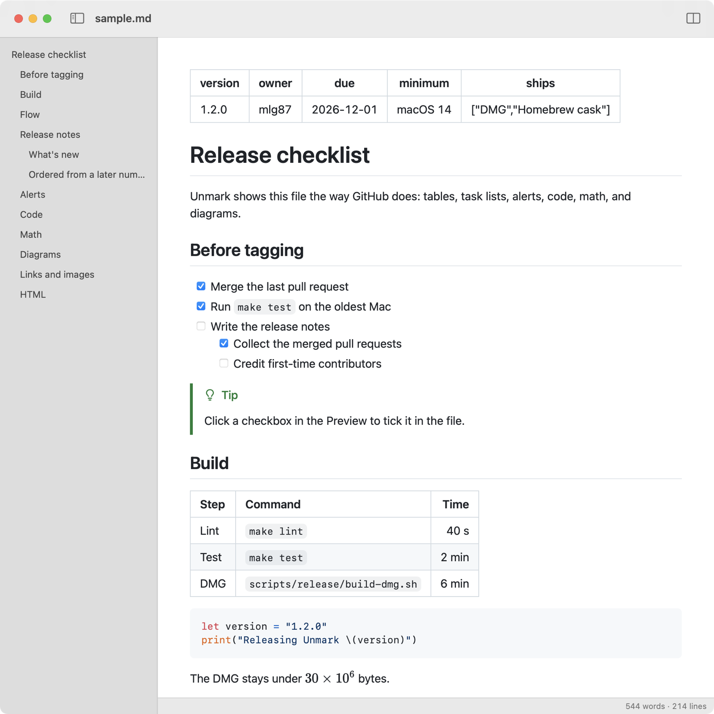
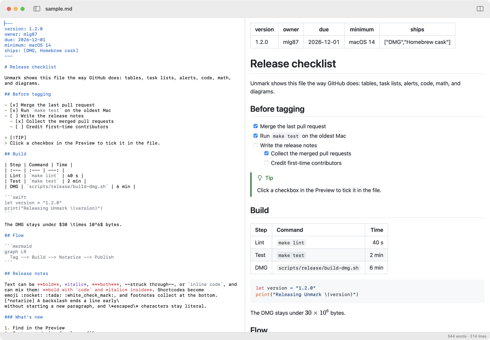
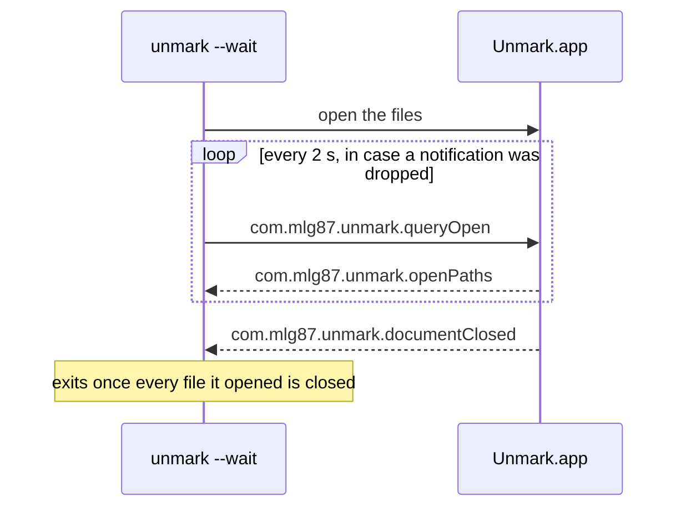
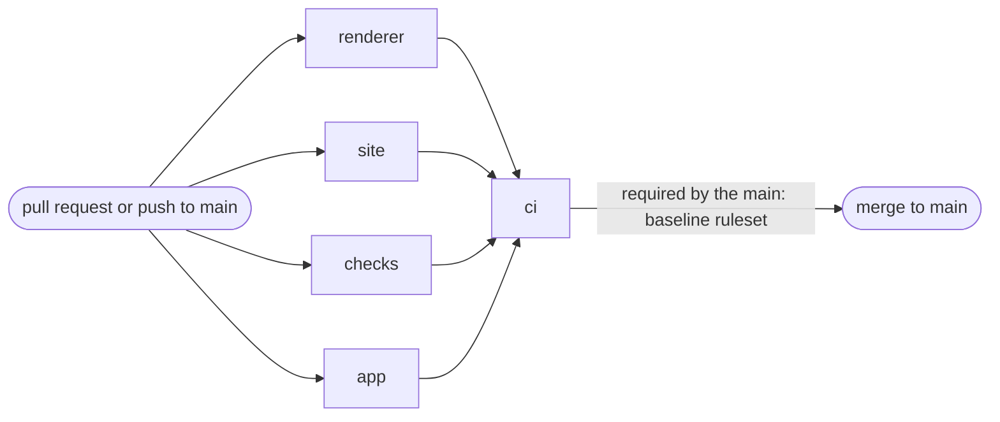
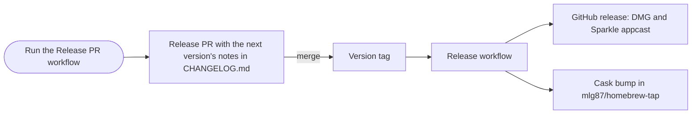

<h1 align="center">
  
</h1>

<p align="center">
  <b>Read and edit markdown on your Mac, shown the way GitHub renders it.</b>
</p>

<p align="center">
  <a href="https://github.com/mlg87/unmark/releases/latest"></a>
  <a href="https://github.com/mlg87/unmark/actions/workflows/ci.yml"></a>
  
  <a href="LICENSE"></a>
</p>

<p align="center">
  <a href="https://unmarkeditor.com"><b>Website</b></a> ·
  <a href="https://github.com/mlg87/unmark/releases/latest"><b>Download</b></a> ·
  <a href="#install"><b>Install</b></a> ·
  <a href="#command-line"><b>Command line</b></a> ·
  <a href="CHANGELOG.md"><b>Changelog</b></a>
</p>

Unmark is a lightweight macOS app for reading and editing markdown files, shown the way GitHub renders them. A file opens in Preview mode: the Preview, styled like github.com, with the Outline of its headings a shortcut away. Split mode puts the Source, the file's markdown, beside the Preview, which updates as you type. Unmark opens only files that exist, saves only when you press <kbd>⌘S</kbd>, and reloads a file when another app changes it.

<picture>
  <source media="(prefers-color-scheme: dark)" srcset="docs/screenshots/preview-dark.png">
  
</picture>

## Install

### Homebrew

```sh
brew install mlg87/tap/unmark
```

This installs `/Applications/Unmark.app` and links the `unmark` command into Homebrew's `bin` (`/opt/homebrew/bin` on Apple silicon, `/usr/local/bin` on Intel). Unmark updates itself, so `brew upgrade` skips it unless you pass `--greedy`. The cask lives in [mlg87/homebrew-tap](https://github.com/mlg87/homebrew-tap).

<details>
<summary><b><code>brew install</code> fails because Unmark is already installed</b></summary>

#### `It seems there is already a Binary at '/usr/local/bin/unmark'`

Settings → Install Command-Line Tool made that link, at the path Intel Homebrew uses too. `--force` doesn't get past this; remove the link and install again:

```sh
sudo rm /usr/local/bin/unmark
brew install mlg87/tap/unmark
```

Settings then shows `Installed at /usr/local/bin/unmark` for Homebrew's link.

#### `It seems there is already an App at '/Applications/Unmark.app'`

You installed it from the DMG. Hand that copy to Homebrew, or quit Unmark and move it to the Trash first:

```sh
brew install --adopt mlg87/tap/unmark
```

</details>

> [!CAUTION]
> Adopting a DMG copy with `--adopt`? Remove a `/usr/local/bin/unmark` link from Settings first: an `--adopt` that fails on the link deletes the existing app.

### DMG

1. Download `Unmark-<version>.dmg` from the [latest release](https://github.com/mlg87/unmark/releases/latest).
2. Open it and drag Unmark onto the Applications folder.
3. Open Unmark from Applications, choose Unmark → Settings… (<kbd>⌘,</kbd>), and click Install Command-Line Tool. Enter your administrator password when macOS asks for it.

> [!NOTE]
> The DMG is signed and notarized by Apple. The first time you open Unmark, macOS asks whether to open an app downloaded from the internet; click Open.

### Try it

In Terminal, in any folder with a `README.md`:

```sh
unmark README.md
```

## Requirements

- macOS 14 Sonoma or later
- An Intel or Apple silicon Mac: Unmark is a universal app

## Using it

### Preview mode and Split mode

Every window opens in Preview mode. View → Show Source (<kbd>⇧⌘E</kbd>), or the button at the window's top right, switches it to Split mode, with the Source on the left and the Preview on the right. Scrolling either one keeps the other on the same line, and the Preview shows each edit as you type. Clicking a task-list checkbox in the Preview ticks it in the Source, in either mode.

<picture>
  <source media="(prefers-color-scheme: dark)" srcset="docs/screenshots/split-dark.png">
  
</picture>

| | |
| --- | --- |
| **Save** | File → Save (<kbd>⌘S</kbd>). There's no autosave; File → Revert to Saved drops unsaved edits. |
| **Changes from other apps** | Unmark reloads the file. If you have unsaved edits, a banner offers Reload from Disk or Keep My Changes instead. |
| **Links** | A link to another markdown file opens it in Unmark, a link to a heading scrolls to it, and any other link opens in its default app. |
| **Status bar** | The Preview's word count and the Source's line count. |

### Outline

View → Show Outline (<kbd>⌃⌘S</kbd>), or the button beside the window's title, lists the document's headings at the window's left. Click one to scroll the Preview to it; the Outline highlights the heading at the Preview's top as you scroll. Showing or hiding it applies to every window.

### Find

Edit → Find → Find… (<kbd>⌘F</kbd>) searches the Preview, or the Source when it has the focus. <kbd>⌘G</kbd> and <kbd>⇧⌘G</kbd> go to the next and previous match. In the Source, <kbd>⌘E</kbd> also uses the selected text as the search; the Preview doesn't support it.

### Zoom

View → Zoom In (<kbd>⌘+</kbd> or <kbd>⌘=</kbd>), Zoom Out (<kbd>⌘-</kbd>), and Actual Size (<kbd>⌘0</kbd>) zoom whichever pane has the focus. The Preview's zoom applies to every window; zooming the Source changes its font size in Settings.

### Print and Export PDF

File → Print… (<kbd>⌘P</kbd>) prints the Preview, never the Source, and File → Export as PDF… saves it as a paginated PDF, by default next to the document. File → Page Setup… (<kbd>⇧⌘P</kbd>) sets the paper size and orientation for both.

### Supported GitHub features

The Preview follows GitHub Flavored Markdown and the extras github.com adds. [`docs/screenshots/sample.md`](docs/screenshots/sample.md) uses every one of them: open it here and in Unmark to compare.

| Feature | Written as |
| --- | --- |
| Tables, task lists, ~~strikethrough~~, and autolinked URLs | `\| a \| b \|`, `- [x] done`, `~~text~~`, `https://…` |
| Alerts | `> [!NOTE]`, `[!TIP]`, `[!IMPORTANT]`, `[!WARNING]`, `[!CAUTION]` |
| Code blocks with syntax highlighting | `` ```swift `` fences |
| Math, rendered by KaTeX: $e^{i\pi} + 1 = 0$ | `$…$`, `$$…$$`, and `` ```math `` blocks |
| Mermaid diagrams | `` ```mermaid `` blocks |
| Footnotes | `text[^1]` and `[^1]: note` |
| Emoji shortcodes :tada: | `:tada:` |
| YAML front matter, shown as a table the way github.com shows it | a `---` block at the top of the file |
| Heading anchors with github.com's IDs | `[link](#section)` |
| Images and links relative to the file | `` |
| HTML, filtered to the tags and attributes github.com allows | `<details>`, `<kbd>`, `<sup>`, … |

## Command line

```sh
unmark [--wait] <file>...
unmark --help | --version
```

`unmark` opens each file in Unmark, launching the app if it isn't running, and brings an already open file's window forward. Files without a markdown extension, like `COMMIT_EDITMSG`, open as markdown. It never creates files: a missing one prints `unmark: <file>: No such file or directory`.

`--wait` returns only once every file it opened has its window closed, saved or not, or Unmark quits. That makes Unmark usable as git's commit message tool:

```sh
GIT_EDITOR="unmark --wait" git commit
git config --global core.editor "unmark --wait"   # for every commit
```

> [!IMPORTANT]
> Save with <kbd>⌘S</kbd> before you close the window: git reads the saved file.

| Exit status | Meaning |
| :---: | --- |
| `0` | Every file opened, and with `--wait`, every window closed |
| `1` | A file doesn't exist (the others still open), Unmark couldn't launch, or with `--wait`, a file couldn't be opened: `unmark: <file>: could not be opened` |
| `2` | Usage error, such as an unknown option |

## Settings

Unmark → Settings… (<kbd>⌘,</kbd>) has four sections:

| Section | What it does |
| --- | --- |
| **Source** | The Source's font, from the monospaced fonts installed (SF Mono by default), and its size, 9 to 36 pt. Open windows follow each change. |
| **Defaults** | Make Unmark the Default Markdown App, so Finder opens markdown files in Unmark. |
| **Command-Line Tool** | Install Command-Line Tool links `/usr/local/bin/unmark` to the tool inside the running copy of Unmark, after the standard administrator password prompt. It shows `Installed at /usr/local/bin/unmark` only while that link resolves to this copy's tool; a link left behind when the app moved shows `Not installed` and a Reinstall button. |
| **Updates** | Automatically check for updates. Unmark → Check for Updates… checks now. |

If you cancel the password prompt or the install fails, a sheet gives the command to run in Terminal instead, and notes when `/usr/local/bin` isn't on your `PATH`:

```sh
sudo mkdir -p /usr/local/bin && sudo ln -sf '/Applications/Unmark.app/Contents/Helpers/unmark' /usr/local/bin/unmark
```

Homebrew installs link the tool themselves; see [Homebrew](#homebrew) if you installed it from Settings first.

## Development setup

Requirements:

- macOS 14 or later with Xcode 16.4 or later
- [Homebrew](https://brew.sh)
- Node.js 22.12 or later and [pnpm](https://pnpm.io). The app target's first build phase runs `scripts/build-renderer.sh`, which installs and builds the `renderer/` package into `App/Resources/Renderer/` on every build, so Xcode builds need them too.

```sh
make bootstrap   # install XcodeGen and SwiftLint from the Brewfile
make project     # generate Unmark.xcodeproj from project.yml
make build       # universal Release build in build/DerivedData
make test        # run the Swift package tests (UnmarkCore and UnmarkAppKit)
make lint        # swift-format, SwiftLint, and Biome checks; run after every change
make format      # apply swift-format, SwiftLint, and Biome fixes
```

`make lint` needs `pnpm --dir renderer install` first so Biome is available.

> [!TIP]
> `Unmark.xcodeproj` is generated and gitignored. Edit `project.yml` and rerun `make project` instead of changing project settings in Xcode.

### Layout

<details>
<summary><b>Where everything lives</b></summary>

| Path | Contents |
| --- | --- |
| `project.yml` | XcodeGen spec for the `Unmark` app target and the `unmark-cli` tool target |
| `App/` | AppKit app target (`NSDocument`, SwiftUI window content, ADR-0003); resources in `App/Resources/`. `App/Info.plist` is generated from `project.yml` |
| `App/Outline/` | The Outline (<kbd>⌃⌘S</kbd>): the document's headings, listed beside the Preview, which scrolls the Preview to the one clicked and selects the one at its top |
| `App/Preview/` | The Preview: a WKWebView that loads the renderer and the document's files from the `unmark://app/` scheme |
| `App/Source/` | The Source: the editable NSTextView shown beside the Preview in Split mode (<kbd>⇧⌘E</kbd>), its markdown syntax colored in GitHub's code palette from `App/Resources/Assets.xcassets` |
| `CLI/` | The `unmark` command-line tool, embedded at `Unmark.app/Contents/Helpers/unmark` |
| `Packages/UnmarkCore/` | Swift package: `UnmarkCore`, pure unit-tested logic (no AppKit or WebKit), and `UnmarkAppKit`, the AppKit pieces whose tests drive a real text view, such as the Source's syntax coloring |
| `renderer/` | pnpm package that bundles the markdown renderer into `App/Resources/Renderer/` |
| `renderer/patches/` | `pnpm patch` fixes to dependencies, applied by `pnpm install` |
| `site/` | pnpm package for the marketing site: Vite and React, prerendered to static HTML in `site/dist/` with the latest release's DMG link fetched at build time |
| `site/infra/` | CloudFormation stack that hosts the site on S3 and CloudFront's Free plan at `unmarkeditor.com`, and its deploy script; see [`docs/website.md`](docs/website.md) |
| `scripts/` | Build and release scripts; `scripts/ci/` holds helpers the CI workflow runs, `scripts/release/` the DMG build |
| `skills/` | The documentation skills for coding agents, one folder each in the Agent Skills format. `renderer/test/skills.test.ts` checks them, and `make sync-skills` copies the two shared references into each. |
| `Artwork/` | The owner's app icon artwork, square and at least 1024 px; `swift scripts/generate-app-icon.swift` renders `AppIcon.appiconset` from it. `Artwork/mark-3d/` holds 3D renders of the `#` mark (front-left, front, top), 2048 px with transparent backgrounds, for the website (#194) |
| `docs/fixtures/` | Markdown documents for checking the Preview by hand, e.g. `kitchen-sink.md` |
| `docs/screenshots/` | This README's screenshots, of the release app showing `sample.md` in a window on a 2x display, scaled to 1600 px wide |

</details>

### How the command-line tool works

The binary is `Unmark.app/Contents/Helpers/unmark`, not `Contents/MacOS/unmark`: on a case-insensitive volume that name would replace the app's own `Unmark` executable. The tool resolves the symlink it's run through to find its app.

For `--wait`, the tool and the app talk over distributed notifications:



A file the app hasn't listed as open 10 s after the open call, and 4 s after its first answer (it can't answer while an alert is up), failed to open: the tool prints `unmark: <path>: could not be opened`, stops waiting on it, and exits 1.

## Continuous integration

`.github/workflows/ci.yml` runs on every pull request and every push to `main`. Four jobs run side by side, so a run takes as long as the slowest of them, `app` (#163). A fifth job, `ci`, waits for those four and fails unless each one succeeded:



`renderer` and `site` run on `ubuntu-latest`; `checks` and `app` run on `macos-15` with Xcode 16.4.

| Job | What it runs |
| --- | --- |
| `renderer` | The renderer tests except the timed one, then the renderer build, which fails if a dependency exceeds its entry-chunk size budget in `renderer/build.mjs`. |
| `site` | Typechecks, tests, and builds the site. The build fails if the latest GitHub release has no `Unmark-*.dmg` asset or the lookup fails, so the site never ships a dead download button, or if the page's JavaScript passes 150 KB gzipped or `index.html` passes 60 KB (`site/scripts/check-budget.mjs`). Then Lighthouse runs on the built pages (`site/lighthouserc.json`) and fails the job if accessibility, best practices, or SEO score below 0.95; performance is reported but never fails it. |
| `checks` | `make lint`, `make test`, the timed renderer test (`test/keystroke-to-preview.test.ts`, whose budget is calibrated to this runner), and `scripts/perf/keystroke-to-preview.swift` for the record: its figure never fails the build (see [below](#keystroke-to-preview-on-the-oldest-mac)). |
| `app` | An ad-hoc signed universal Release build, and every check that needs it (below). |

`app` fails unless each of these passes, in order:

1. `lipo -archs` reports both `x86_64` and `arm64` for the app and the embedded `unmark` tool.
2. The tool's exit statuses for usage errors and missing files are right.
3. Launched with `unmark a.md b.md`, the tool exits 0 within 10 s and the app then reports both files open, asked over `com.mlg87.unmark.queryOpen` by `scripts/ci/open-documents.swift`.
4. `GIT_EDITOR="unmark --wait" git commit` in a scratch repo is still running 5 s after the app reports `COMMIT_EDITMSG` open, then commits the message once `osascript` clicks the window's close button.
5. `scripts/ci/check-updates.sh` checks Sparkle in copies of the app re-signed with a local feed URL: a scheduled check against an unreachable feed opens no dialog, the Settings toggle reads and writes `SUEnableAutomaticChecks`, and Check for Updates… offers a newer version from an appcast served on `127.0.0.1`.

The `main: baseline` ruleset requires the `ci` check (pinned to the GitHub Actions app) before a pull request can merge, so red builds can't land on `main`. GitHub lists the check as `ci`; pull requests show it as `CI / ci`.

### Keystroke-to-preview on the oldest Mac

q47 holds typing in a 1 MB file to under 250 ms before the Preview shows it. CI can't check that: the runner's WebKit timings vary 2x between runs. So `scripts/perf/keystroke-to-preview-gate.sh` runs `scripts/perf/keystroke-to-preview.swift` on the maintainer's 2019 i9 MacBook Pro, of the oldest generation macOS 14 supports, once for each new `main`.

- **Focus:** the harness's window must be in front, so it waits until nobody has used the keyboard or mouse for 2 minutes, and retries a run the window lost focus in or one on a locked screen.
- **Pass:** sets the `q47 keystroke-to-preview` status on the commit.
- **Fail:** a median over 210 ms[^debounce] twice in a row sets a failure status and files a GitHub issue and a bead.
- **Schedule:** launchd checks every 15 minutes once you run `scripts/perf/keystroke-to-preview-gate.sh install-schedule` in the primary checkout; the log is `~/Library/Logs/unmark-keystroke-to-preview-gate.log`.

[^debounce]: 250 ms less the 40 ms edit debounce.

## Releasing

`scripts/release/build-dmg.sh <version>` builds a universal, Developer ID signed, notarized, and stapled `Unmark-<version>.dmg`, and fails if it's 30 MB or more. The Release workflow runs it in CI. To release, run the **Release PR** workflow:



[docs/releasing.md](docs/releasing.md) covers the certificate, the notary credentials and repository secrets, the tap, running it on a Mac with Xcode, and renewing the certificate before it expires on **2027-12-13**.

## License

[MIT](LICENSE)
