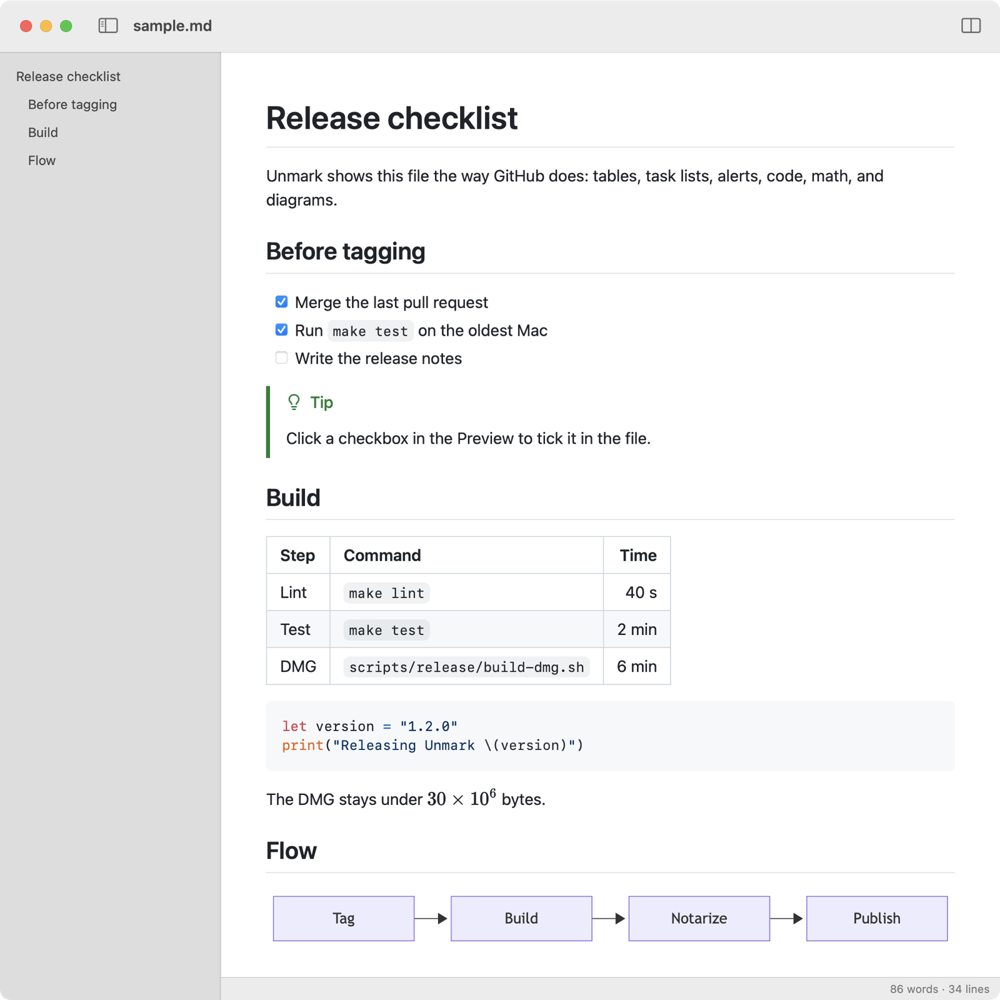
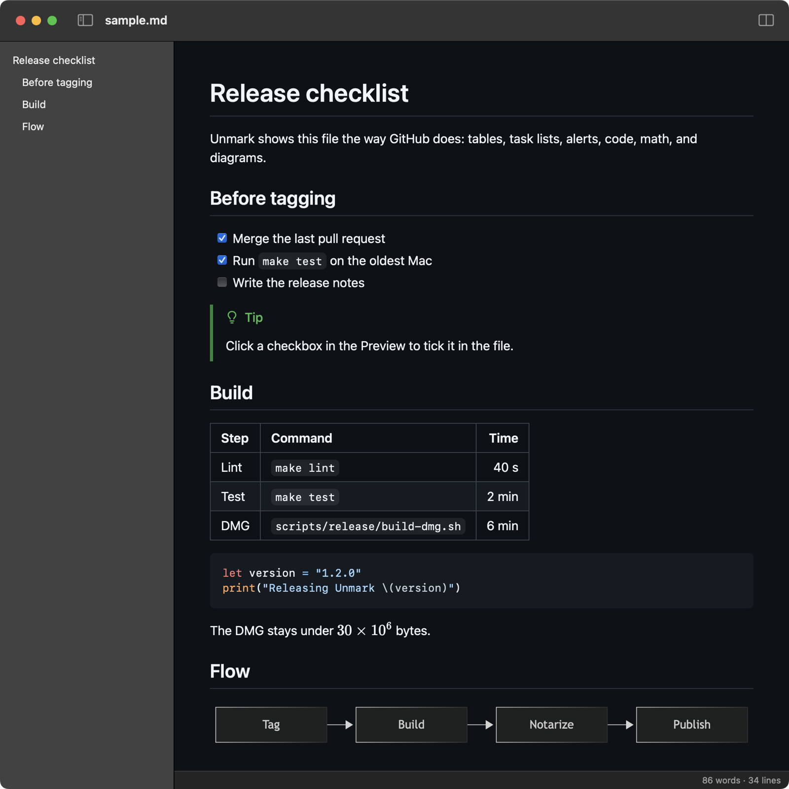
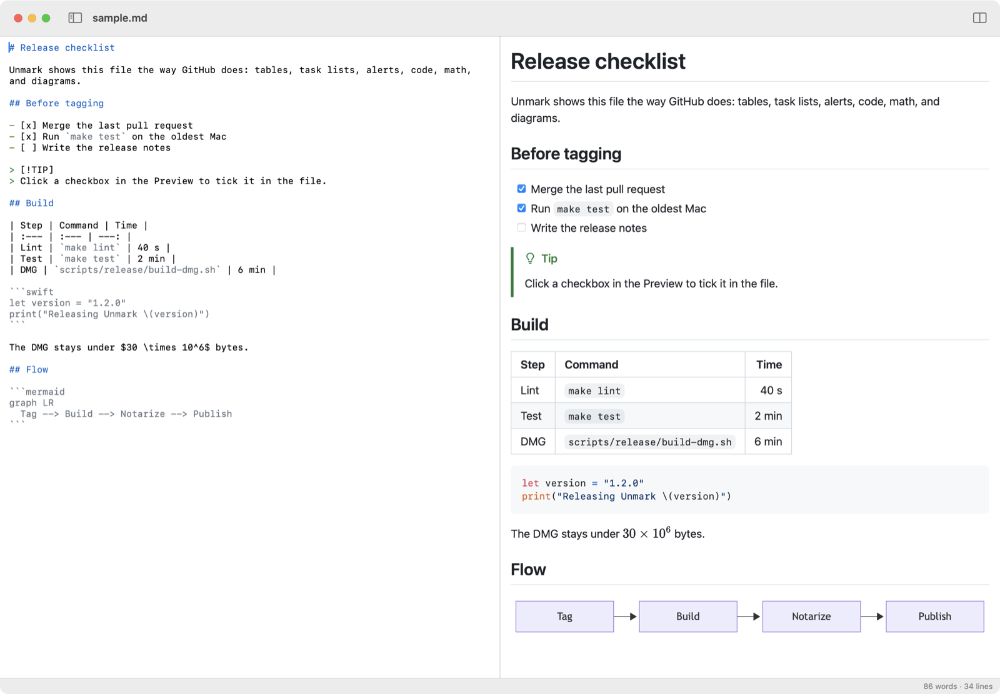
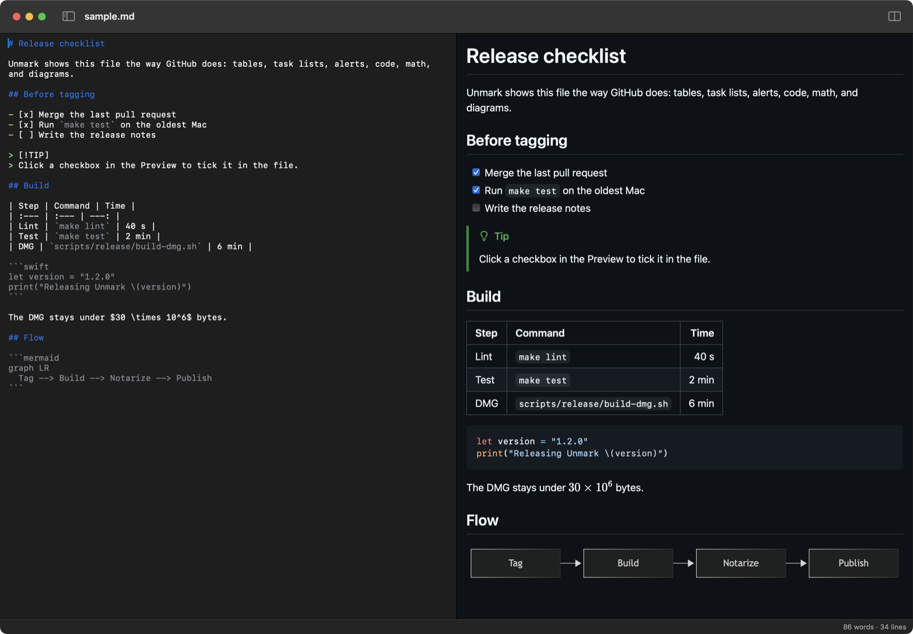

# 

Unmark is a lightweight macOS app for reading and editing markdown files, shown the way GitHub renders them. A file opens in Preview mode: the Preview, styled like github.com, with the Outline of its headings a shortcut away. Split mode puts the Source, the file's markdown, beside the Preview, which updates as you type. Unmark opens only files that exist, saves only when you press ⌘S, and reloads a file when another app changes it.

| | Light | Dark |
| --- | --- | --- |
| Preview mode, with the Outline |  |  |
| Split mode |  |  |

## Install

### Homebrew

```sh
brew install mlg87/tap/unmark
```

This installs `/Applications/Unmark.app` and links the `unmark` command into Homebrew's `bin` (`/opt/homebrew/bin` on Apple silicon, `/usr/local/bin` on Intel). Unmark updates itself, so `brew upgrade` skips it unless you pass `--greedy`. The cask lives in [mlg87/homebrew-tap](https://github.com/mlg87/homebrew-tap).

If Unmark is already installed, `brew install` fails with one of these:

- `It seems there is already a Binary at '/usr/local/bin/unmark'`: Settings → Install Command-Line Tool made that link, at the path Intel Homebrew uses too. Remove it with `sudo rm /usr/local/bin/unmark` and run `brew install` again; `--force` doesn't get past this. Settings then shows `Installed at /usr/local/bin/unmark` for Homebrew's link. Remove the link before using `--adopt` below: an `--adopt` that fails on the link deletes the existing app.
- `It seems there is already an App at '/Applications/Unmark.app'`: you installed it from the DMG. Run `brew install --adopt mlg87/tap/unmark` to hand that copy to Homebrew, or quit Unmark and move it to the Trash first.

### DMG

1. Download `Unmark-<version>.dmg` from the [latest release](https://github.com/mlg87/unmark/releases/latest).
2. Open it and drag Unmark onto the Applications folder.
3. Open Unmark from Applications, choose Unmark → Settings… (⌘,), and click Install Command-Line Tool. Enter your administrator password when macOS asks for it.

The DMG is signed and notarized by Apple. The first time you open Unmark, macOS asks whether to open an app downloaded from the internet; click Open.

### Try it

In Terminal, in any folder with a `README.md`:

```sh
unmark README.md
```

## Requirements

- macOS 14 Sonoma or later
- An Intel or Apple silicon Mac: Unmark is a universal app

## Using it

### Preview mode and Split mode

Every window opens in Preview mode. View → Show Source (⇧⌘E), or the button at the window's top right, switches it to Split mode, with the Source on the left and the Preview on the right. Scrolling either one keeps the other on the same line, and the Preview shows each edit as you type. Clicking a task-list checkbox in the Preview ticks it in the Source, in either mode.

- **Save**: File → Save (⌘S). There's no autosave; File → Revert to Saved drops unsaved edits.
- **Changes from other apps**: Unmark reloads the file. If you have unsaved edits, a banner offers Reload from Disk or Keep My Changes instead.
- **Links**: a link to another markdown file opens it in Unmark, a link to a heading scrolls to it, and any other link opens in its default app.
- **Status bar**: the Preview's word count and the Source's line count.

### Outline

View → Show Outline (⌃⌘S), or the button beside the window's title, lists the document's headings at the window's left. Click one to scroll the Preview to it; the Outline highlights the heading at the Preview's top as you scroll. Showing or hiding it applies to every window.

### Find

Edit → Find → Find… (⌘F) searches the Preview, or the Source when it has the focus. ⌘G and ⇧⌘G go to the next and previous match. In the Source, ⌘E also uses the selected text as the search; the Preview doesn't support it.

### Zoom

View → Zoom In (⌘+ or ⌘=), Zoom Out (⌘-), and Actual Size (⌘0) zoom whichever pane has the focus. The Preview's zoom applies to every window; zooming the Source changes its font size in Settings.

### Print and Export PDF

File → Print… (⌘P) prints the Preview, never the Source, and File → Export as PDF… saves it as a paginated PDF, by default next to the document. File → Page Setup… (⇧⌘P) sets the paper size and orientation for both.

### Supported GitHub features

The Preview follows GitHub Flavored Markdown and the extras github.com adds:

- Tables, task lists, ~~strikethrough~~, and autolinked URLs
- Alerts: `> [!NOTE]`, `[!TIP]`, `[!IMPORTANT]`, `[!WARNING]`, and `[!CAUTION]`
- Fenced code blocks with syntax highlighting
- Math with `$…$`, `$$…$$`, and ` ```math ` blocks, rendered by KaTeX
- Mermaid diagrams in ` ```mermaid ` blocks
- Footnotes
- Emoji shortcodes such as `:tada:`
- YAML front matter, shown as a table the way github.com shows it
- Heading anchors with github.com's IDs, so `#section` links work
- Images and links relative to the file
- HTML, filtered to the tags and attributes github.com allows

## Command line

```sh
unmark [--wait] <file>...
unmark --help | --version
```

`unmark` opens each file in Unmark, launching the app if it isn't running, and brings an already open file's window forward. Files without a markdown extension, like `COMMIT_EDITMSG`, open as markdown. It never creates files: a missing one prints `unmark: <file>: No such file or directory`.

`--wait` returns only once every file it opened has its window closed, saved or not, or Unmark quits. That makes Unmark usable as git's commit message tool; save with ⌘S before you close the window, since git reads the saved file:

```sh
GIT_EDITOR="unmark --wait" git commit
git config --global core.editor "unmark --wait"   # for every commit
```

| Exit status | Meaning |
| --- | --- |
| 0 | Every file opened, and with `--wait`, every window closed |
| 1 | A file doesn't exist (the others still open), Unmark couldn't launch, or with `--wait`, a file couldn't be opened: `unmark: <file>: could not be opened` |
| 2 | Usage error, such as an unknown option |

## Settings

Unmark → Settings… (⌘,) has four sections:

- **Source**: the Source's font, from the monospaced fonts installed (SF Mono by default), and its size, 9 to 36 pt. Open windows follow each change.
- **Defaults**: Make Unmark the Default Markdown App, so Finder opens markdown files in Unmark.
- **Command-Line Tool**: Install Command-Line Tool links `/usr/local/bin/unmark` to the tool inside the running copy of Unmark, after the standard administrator password prompt. It shows `Installed at /usr/local/bin/unmark` only while that link resolves to this copy's tool; a link left behind when the app moved shows `Not installed` and a Reinstall button. If you cancel the prompt or the install fails, a sheet gives the command to run in Terminal instead:

  ```sh
  sudo mkdir -p /usr/local/bin && sudo ln -sf '/Applications/Unmark.app/Contents/Helpers/unmark' /usr/local/bin/unmark
  ```

  It also notes when `/usr/local/bin` isn't on your `PATH`. Homebrew installs link the tool themselves; see [Homebrew](#homebrew) if you installed it from Settings first.
- **Updates**: Automatically check for updates. Unmark → Check for Updates… checks now.

## Development setup

Requirements:

- macOS 14 or later with Xcode 16.4 or later
- [Homebrew](https://brew.sh)
- Node.js 22.12 or later and [pnpm](https://pnpm.io). The app target's first build
  phase runs `scripts/build-renderer.sh`, which installs and builds the `renderer/`
  package into `App/Resources/Renderer/` on every build, so Xcode builds need them too.

```sh
make bootstrap   # install XcodeGen and SwiftLint from the Brewfile
make project     # generate Unmark.xcodeproj from project.yml
make build       # universal Release build in build/DerivedData
make test        # run the UnmarkCore package tests
make lint        # swift-format, SwiftLint, and Biome checks; run after every change
make format      # apply swift-format, SwiftLint, and Biome fixes
```

`make lint` needs `pnpm --dir renderer install` first so Biome is available.

`Unmark.xcodeproj` is generated and gitignored. Edit `project.yml` and rerun
`make project` instead of changing project settings in Xcode.

### Layout

| Path | Contents |
| --- | --- |
| `project.yml` | XcodeGen spec for the `Unmark` app target and the `unmark-cli` tool target |
| `App/` | AppKit app target (`NSDocument`, SwiftUI window content, ADR-0003); resources in `App/Resources/`. `App/Info.plist` is generated from `project.yml` |
| `App/Outline/` | The Outline (⌃⌘S): the document's headings, listed beside the Preview, which scrolls the Preview to the one clicked and selects the one at its top |
| `App/Preview/` | The Preview: a WKWebView that loads the renderer and the document's files from the `unmark://app/` scheme |
| `App/Source/` | The Source: the editable NSTextView shown beside the Preview in Split mode (⇧⌘E), its markdown syntax colored in GitHub's code palette from `App/Resources/Assets.xcassets` |
| `CLI/` | The `unmark` command-line tool, embedded at `Unmark.app/Contents/Helpers/unmark` |
| `Packages/UnmarkCore/` | Swift package with pure, unit-tested logic (no AppKit or WebKit) |
| `renderer/` | pnpm package that bundles the markdown renderer into `App/Resources/Renderer/` |
| `renderer/patches/` | `pnpm patch` fixes to dependencies, applied by `pnpm install` |
| `scripts/` | Build and release scripts; `scripts/ci/` holds helpers the CI workflow runs, `scripts/release/` the DMG build |
| `Artwork/` | The owner's app icon artwork, square and at least 1024 px; `swift scripts/generate-app-icon.swift` renders `AppIcon.appiconset` from it |
| `docs/fixtures/` | Markdown documents for checking the Preview by hand, e.g. `kitchen-sink.md` |
| `docs/screenshots/` | This README's screenshots, of the release app showing `sample.md` in a window on a 2x display, scaled to 1600 px wide |

### How the command-line tool works

The binary is `Unmark.app/Contents/Helpers/unmark`, not `Contents/MacOS/unmark`:
on a case-insensitive volume that name would replace the app's own `Unmark`
executable. The tool resolves the symlink it's run through to find its app.

For `--wait`, the app announces closed windows with the distributed notification
`com.mlg87.unmark.documentClosed` and answers `com.mlg87.unmark.queryOpen` with
`com.mlg87.unmark.openPaths`, which the tool polls every 2 s in case a
notification was dropped. A file the app hasn't listed as open 10 s after the
open call, and 4 s after its first answer (it can't answer while an alert is
up), failed to open: the tool prints `unmark: <path>: could not be opened`,
stops waiting on it, and exits 1.

## Continuous integration

`.github/workflows/ci.yml` runs on every pull request and every push to `main`
on a `macos-15` runner with Xcode 16.4. A single job, `ci`, runs `make lint`, the
renderer tests, the renderer build (which fails if a dependency exceeds its
entry-chunk size budget in `renderer/build.mjs`), `make test`, and an ad-hoc signed
universal Release build. It then fails unless `lipo -archs` reports both `x86_64`
and `arm64` for the app and the embedded `unmark` tool, and checks the tool's exit
statuses for usage errors and missing files. Then it launches the app with
`unmark a.md b.md` and fails unless the tool exits 0 within 10 s and the app then
reports both files open, asked over `com.mlg87.unmark.queryOpen` by
`scripts/ci/open-documents.swift`. Then it runs `GIT_EDITOR="unmark --wait" git
commit` in a scratch repo and fails unless git is still running 5 s after the app
reports `COMMIT_EDITMSG` open, then commits the message once `osascript` clicks the
window's close button. Last, `scripts/ci/check-updates.sh` checks Sparkle in copies
of the app re-signed with a local feed URL: a scheduled check against an
unreachable feed opens no dialog, the Settings toggle reads and writes
`SUEnableAutomaticChecks`, and Check for Updates… offers a newer version from an
appcast served on `127.0.0.1`.

The `main: baseline` ruleset requires the `ci` check (pinned to the GitHub
Actions app) before a pull request can merge, so red builds can't land on
`main`. GitHub lists the check as `ci`; pull requests show it as `CI / ci`.

### Keystroke-to-preview on the oldest Mac

q47 holds typing in a 1 MB file to under 250 ms before the Preview shows it.
CI can't check that: the runner's WebKit timings vary 2x between runs. So
`scripts/perf/keystroke-to-preview-gate.sh` runs
`scripts/perf/keystroke-to-preview.swift` on the maintainer's 2019 i9 MacBook
Pro, of the oldest generation macOS 14 supports, once for each new `main`. It
needs the harness's window in front, so it waits until nobody has used the
keyboard or mouse for 2 minutes, and retries a run the window lost focus in or
one on a locked screen. A pass sets the `q47 keystroke-to-preview` status on the
commit. A median over 210 ms (250 ms less the 40 ms edit debounce) twice in a
row sets a failure status and files a GitHub issue and a bead. launchd checks
every 15 minutes once you run `scripts/perf/keystroke-to-preview-gate.sh
install-schedule` in the primary checkout; the log is
`~/Library/Logs/unmark-keystroke-to-preview-gate.log`.

## Releasing

`scripts/release/build-dmg.sh <version>` builds a universal, Developer ID
signed, notarized, and stapled `Unmark-<version>.dmg`, and fails if it's 30 MB
or more. The Release workflow runs it in CI. On a `v*` tag it also publishes
the DMG and Sparkle appcast to a GitHub release and bumps the cask in
[mlg87/homebrew-tap](https://github.com/mlg87/homebrew-tap).
[docs/releasing.md](docs/releasing.md) covers the certificate, the notary
credentials and repository secrets, the tap, running it on a Mac with Xcode,
and renewing the certificate before it expires on 2027-12-13.

## License

[MIT](LICENSE)
