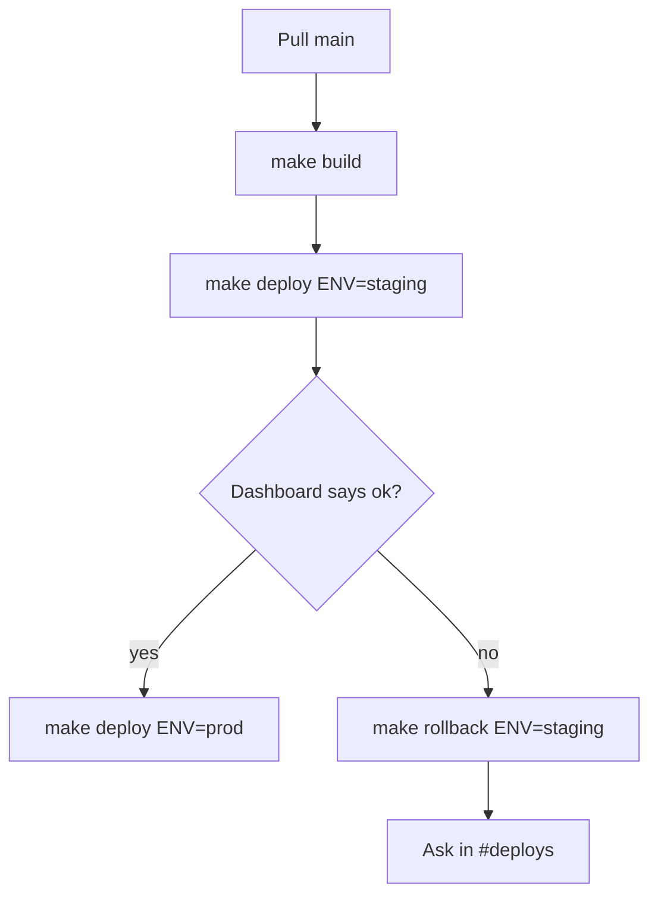

# Deploy notes

## Before you start

- You need access to the prod cluster.
- You should make sure the migrations have been run first. If they have not been run, the app will crash on boot. This has happened twice.

> [!IMPORTANT]
> Never deploy on Fridays after 3pm.

## Deploy



1. Pull `main`.
2. Run the build and wait for it to finish. It takes about 4 minutes.

   ```sh
   make build
   ```

3. Deploy to staging.

   ```sh
   make deploy ENV=staging
   ```

4. Check the staging dashboard at <https://staging.example.com/health>.
5. If the dashboard says ok, deploy to prod.

   ```sh
   make deploy ENV=prod
   ```

6. If the dashboard does not say ok, roll back staging and ask in #deploys.

   ```sh
   make rollback ENV=staging
   ```

## Staging vs prod

| Attribute | Staging | Prod |
| --- | --- | --- |
| Replicas | 1 | 6 |
| Payment key | Test | Live |
| Deploy time | About 2 minutes | About 10 minutes |

The prod deploy takes longer because of the rolling restart.
