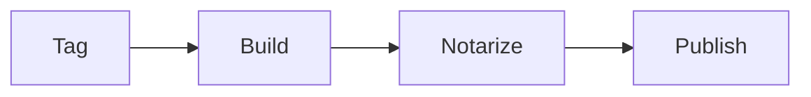
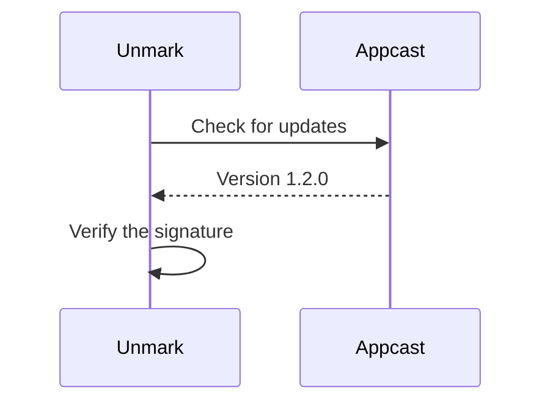
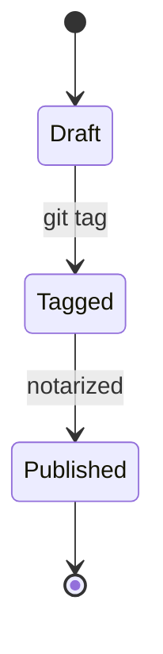
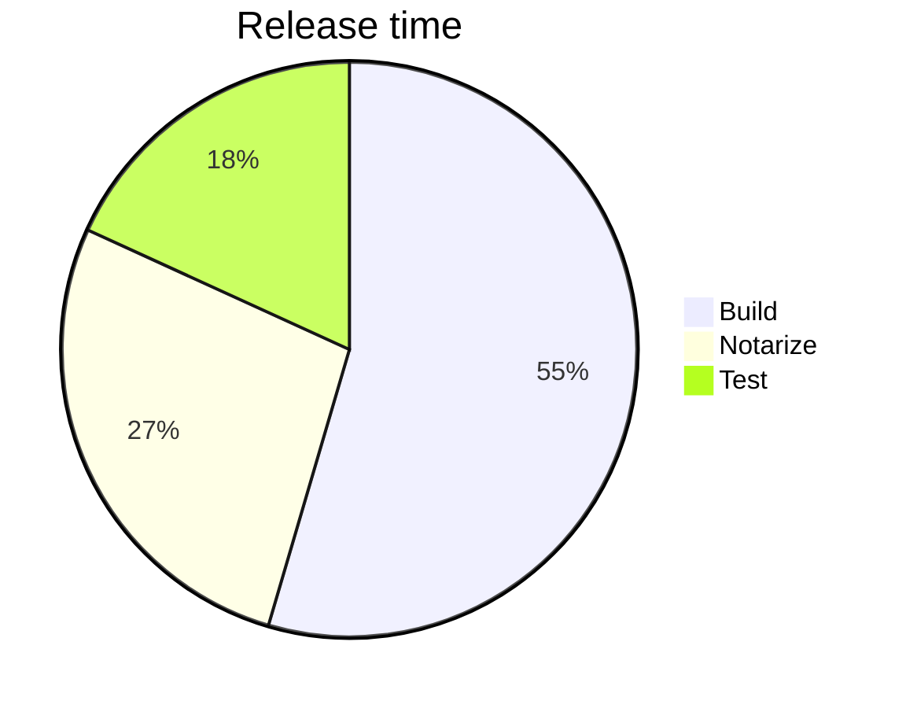
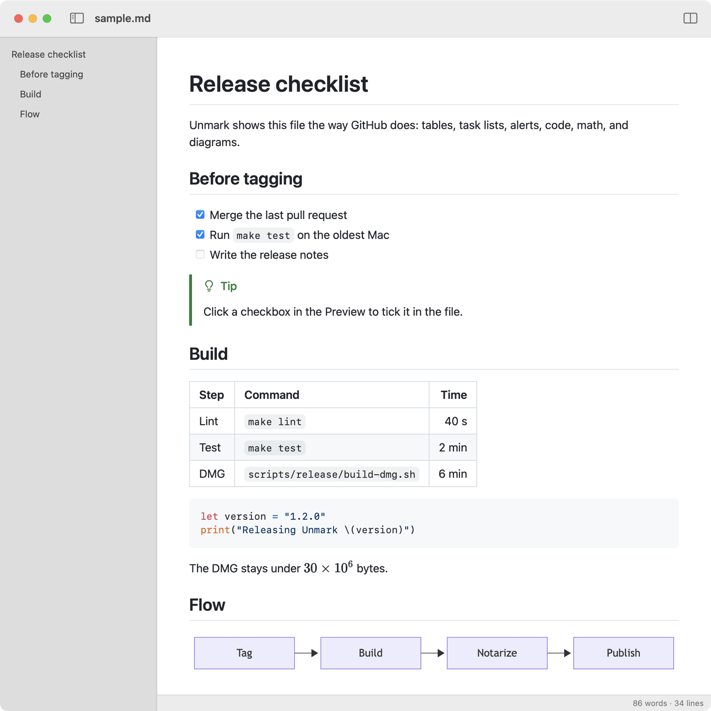

# Release checklist

Unmark shows this file the way GitHub does: tables, task lists, alerts, code, math, and diagrams.

## Before tagging

- [x] Merge the last pull request
- [x] Run `make test` on the oldest Mac
- [ ] Write the release notes
  - [x] Collect the merged pull requests
  - [ ] Credit first-time contributors

> [!TIP]
> Click a checkbox in the Preview to tick it in the file.

## Build

| Step | Command | Time |
| :--- | :--- | ---: |
| Lint | `make lint` | 40 s |
| Test | `make test` | 2 min |
| DMG | `scripts/release/build-dmg.sh` | 6 min |

```swift
let version = "1.2.0"
print("Releasing Unmark \(version)")
```

The DMG stays under $30 \times 10^6$ bytes.

## Flow



## Release notes

Text can be **bold**, *italic*, ***both***, ~~struck through~~, or `inline code`, and can mix them: **bold with `code` and *italic* inside**. Shortcodes become emoji :rocket: :tada: :white_check_mark:, and footnotes collect at the bottom.[^notarize] A backslash ends a line early\
without starting a new paragraph, and \*escaped\* characters stay literal.

### What's new

1. Find in the Preview
2. Faster rendering for large files
   1. Only changed blocks redraw
   2. Diagrams and math load on first use
3. Print and export to PDF

### Ordered from a later number

7. Seventh step
8. Eighth step

> Quoting the changelog:
>
> > Unmark now keeps your scroll position when the file changes on disk.
>
> — the 1.1.0 release notes

## Alerts

> [!NOTE]
> Unmark updates itself through Sparkle.

> [!TIP]
> Check the DMG on a clean Mac before you publish it.

> [!IMPORTANT]
> Notarize every build before you publish it.

> [!WARNING]
> The appcast must list the new version before the DMG goes live.

> [!CAUTION]
> Deleting a published tag breaks every update check that points at it.

## Code

Fences with a language are highlighted with GitHub's colors:

```sh
git tag -s v1.2.0 -m "Unmark 1.2.0"
git push origin v1.2.0
```

```json
{ "version": "1.2.0", "minimumSystemVersion": "14.0", "signed": true }
```

```yaml
on:
  push:
    tags: ["v*"]
```

```diff
- let timeout = 30
+ let timeout = 60
```

```ts
export function slug(text: string): string {
  return text.toLowerCase().replace(/\s+/g, "-");
}
```

A fence without a language, or an indented block, stays plain:

```text
Unmark-1.2.0.dmg  28.4 MB
```

    codesign --verify --deep --strict Unmark.app

## Math

Inline math sits in a sentence: notarization takes $t \approx 3\,\text{min}$, and a download of $n$ bytes at $r$ bytes per second takes $\frac{n}{r}$ seconds.

Display math gets its own line:

$$
P(\text{update}) = 1 - \prod_{i=1}^{k} (1 - p_i)
$$

So does a `math` fence:

```math
\begin{bmatrix} a & b \\ c & d \end{bmatrix}
\begin{bmatrix} x \\ y \end{bmatrix}
=
\begin{bmatrix} ax + by \\ cx + dy \end{bmatrix}
```

## Diagrams

Diagrams follow the light or dark appearance.







## Links and images

- An autolink: <https://github.com/mlg87/unmark>
- A bare URL: https://github.com/mlg87/unmark/releases
- A `www.` link: www.github.com
- An email: <releases@example.com>
- A [relative link](../releasing.md) to another file
- A [link to a heading](#build) in this file, which every heading gets

[](../../LICENSE)

<p align="center">
  
</p>

<picture>
  <source media="(prefers-color-scheme: dark)" srcset="preview-dark.png">
  
</picture>

## HTML

GitHub's raw HTML works too: <kbd>⌘</kbd> <kbd>P</kbd> prints, H<sub>2</sub>O and E = mc<sup>2</sup> set small, <mark>marked</mark>, <ins>inserted</ins>, and <del>deleted</del> text, and <abbr title="Disk image">DMG</abbr> explains itself on hover.

<details>
<summary>Signing details</summary>

The app is signed with a Developer ID certificate and notarized by Apple, so Gatekeeper opens it without a warning.

</details>

<dl>
  <dt>Appcast</dt>
  <dd>The feed Sparkle reads to find new versions.</dd>
  <dt>DMG</dt>
  <dd>The disk image the app ships in.</dd>
</dl>

---

That's every element Unmark renders.

[^notarize]: Apple's notary service usually answers within a few minutes.
