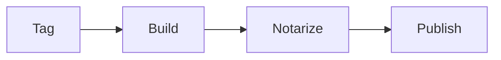

# Release checklist

Unmark shows this file the way GitHub does: tables, task lists, alerts, code, math, and diagrams.

## Before tagging

- [x] Merge the last pull request
- [x] Run `make test` on the oldest Mac
- [ ] Write the release notes

> [!TIP]
> Click a checkbox in the Preview to tick it in the file.

## Build

| Step | Command | Time |
| :--- | :--- | ---: |
| Lint | `make lint` | 40 s |
| Test | `make test` | 2 min |
| DMG | `scripts/release/build-dmg.sh` | 6 min |

```swift
let version = "1.2.0"
print("Releasing Unmark \(version)")
```

The DMG stays under $30 \times 10^6$ bytes.

## Flow


