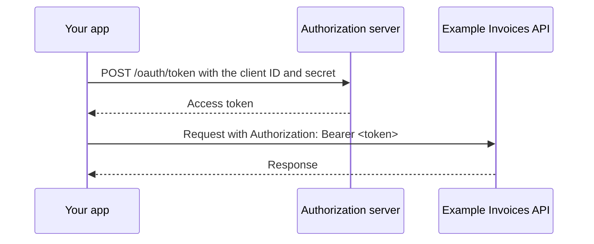

# Document a REST API

A REST reference has one overview page and one page for each resource. The overview gives the facts that apply to every request. A resource page gives one section for each endpoint. See [`../assets/rest-overview.md`](../assets/rest-overview.md) and [`../assets/rest-endpoint.md`](../assets/rest-endpoint.md) for complete pages.

The terms here follow the OpenAPI Specification: <https://spec.openapis.org/oas/latest.html>. In an OpenAPI file, `servers` gives the base URL, `paths` gives the endpoints, `parameters` gives the path, query, and header parameters, `requestBody` gives the request body, `responses` gives each status code, and `components.securitySchemes` gives the authentication.

## Default layout

Use this layout only when the repository has no API documentation to copy:

- `docs/api/README.md`: the overview page.
- `docs/api/<resource>.md`: one page for each resource, such as `docs/api/invoices.md`. A resource is the first part of the path, such as `invoices` in `/invoices/{id}`. Put a webhook on the page of the resource that sends it.

## Overview page

The overview page has a `#` title with the name of the API, one sentence on what the API does, and these parts in this order:

| Part | What it gives |
| --- | --- |
| Base URL | The URL that every path starts with |
| Authentication | Where the credential goes, with an example header |
| Versioning | Where the version goes, and what a new version changes |
| Requests and responses | The media type of a body, and each format of a date, an amount, or an ID that the source states |
| Pagination | The parameters that select a page, and the fields that point to the next page |
| Rate limits | The limit, the status code when a client goes over it, and the header that says when to try again |
| Errors | The body of an error response, and the status codes that every endpoint can return |
| Idempotency | The header that makes a retry safe, and how long the API keeps its key |

- Include a part only when the source shows the API has it. Delete the other parts. Do not write that the API has no rate limit or no pagination, because the source does not say that.
- End the page with a list of links to the resource pages.

## Resource page

A resource page has a `#` title with the name of the resource, one sentence on what the resource is, and a link to the overview. Then comes `## The <resource> object`: a table of the fields of the object that the endpoints return, with the columns `Field`, `Type`, and `Description`. Write the enum values of a field in its description. The endpoint sections follow, then the webhooks.

## Endpoint section

Give each endpoint one `##` section, in the order of the source. A section has these parts in this order:

1. A heading that names the action in words, such as `## Create an invoice`. Take the words from the source's `summary` when it has one.
2. The method and the path in a code span, such as `` `POST /invoices` ``. Write the path as the source's `paths` writes it, without the base URL: `` `GET /invoices/{id}` ``, not `` `GET /v1/invoices/{id}` ``.
3. One sentence on what the endpoint does.
4. A `###` table for each kind of input that the endpoint has: `### Path parameters`, `### Query parameters`, `### Headers`, and `### Request body`. Each table has the columns `Name`, `Type`, `Required`, and `Description`. Leave out a table for a kind of input the endpoint does not have.
5. `### Example request`: a `curl` command in an `sh` fence.
6. `### Responses`: one `####` heading for each success status code that the source lists, such as `#### 201 Created`. Under it, one sentence from the source's `description`, then the body in a `json` fence. Give a fence only for a body that the source defines.
7. `### Errors`: a table with the columns `Status`, `Code`, and `When`, with one row for each error status code that the source lists for the endpoint. `Code` is the error code in the response body. Leave out the `Code` column when the source defines no error codes. Leave out the section when the source lists no error response.

```markdown
### Query parameters

| Name | Type | Required | Description |
| --- | --- | --- | --- |
| `status` | string | No | Return only invoices with this status: `draft`, `open`, `paid`, or `void`. |
| `limit` | integer | No | The number of invoices to return. Default `10`. Maximum `50`. |
```

## Conventions

- Write each type as the source writes it, such as `string`, `integer`, or `string (date-time)`. For an array, write `array of <type>`. For an object, name the schema, such as `Invoice`.
- Write `Yes` or `No` in the `Required` column.
- Put a default, a minimum, a maximum, and a length limit in the description, such as "Default `10`. Maximum `50`."
- Write each enum value as code, such as `paid`.
- Document only the status codes that the source lists for an endpoint. Authentication in the source does not add a `401`, and a parameter does not add a `400`.
- Write a field of the request body as its name. Write a nested field with dots, such as `address.city`.
- A deprecated endpoint is struck through in its heading, such as `## ~~Close an invoice~~`. Its first sentence names the endpoint that replaces it, with a link.
- An authentication flow of 3 or more steps gets a `sequenceDiagram`:

````markdown

````

## Webhooks

Give each webhook event one `##` section on the page of its resource, with these parts:

- The event name in the heading, as code, such as ``## Webhook: `invoice.paid` ``.
- When the API sends the event, in one sentence.
- A payload table with the columns `Field`, `Type`, and `Description`, and an example payload in a `json` fence.
- How to verify the signature, as numbered steps, with the header name and the algorithm from the source.
- The retry policy: when the API retries, how many times, and at what intervals.

Write `TBD` for a part that the source does not give. A reader who cannot verify the signature cannot use the webhook safely.

## Check

- [ ] Each endpoint in the source has one section, and each section has an endpoint in the source.
- [ ] Each path is written as the source writes it, without the base URL.
- [ ] Each parameter, field, type, default, and limit comes from the source.
- [ ] Each status code comes from the source's `responses` for that endpoint.
- [ ] Each endpoint has a `curl` example in an `sh` fence.
- [ ] Each response body in the source has a `json` fence.
- [ ] The overview has no part that the source does not show.
