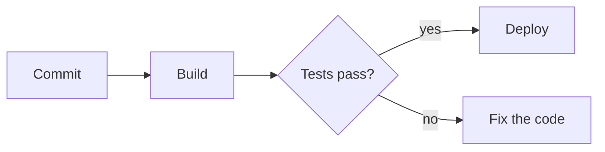
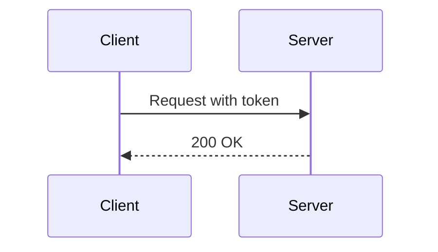
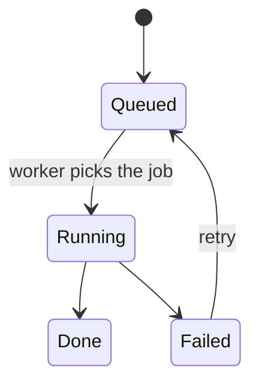
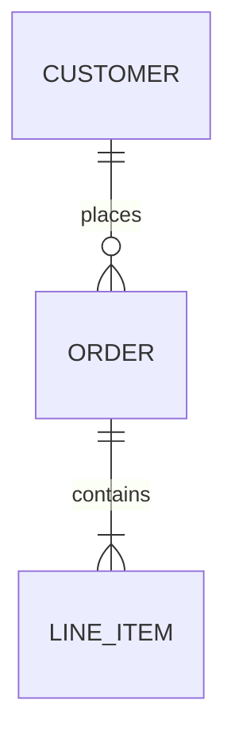
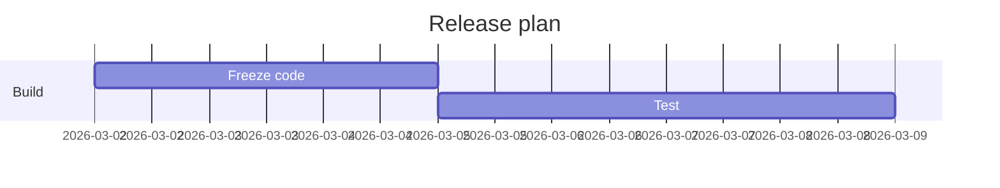
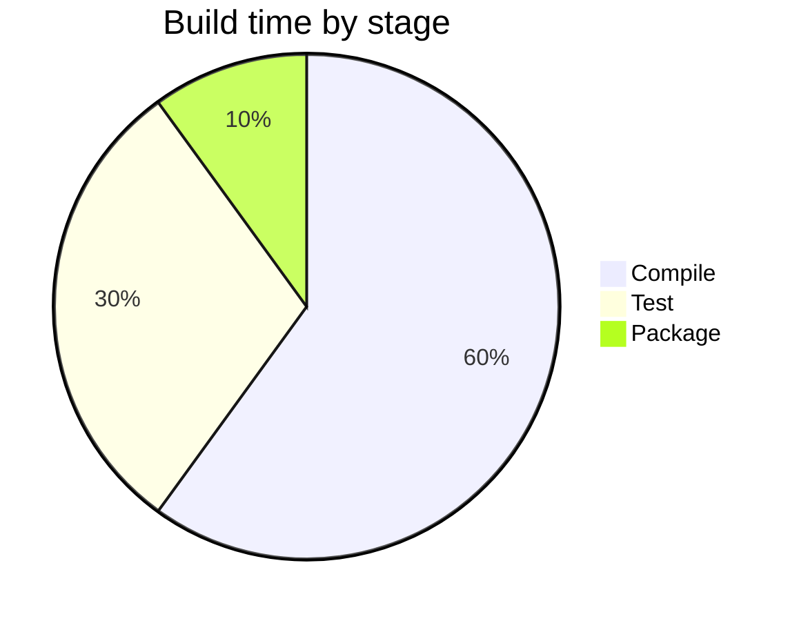

# Markdown elements and their limits

This file tells you which markdown element to use for each kind of content. Every element here renders in Unmark and on github.com.

## Pick an element

Find the kind of content in the left column. Use the element in the middle column.

| Content | Element | Section |
| --- | --- | --- |
| Options compared on shared attributes | Table | [Table](#table) |
| Steps in a fixed order | Numbered list | [Numbered list](#numbered-list) |
| Facts in no order | Bullets | [Bullet list](#bullet-list) |
| Things the reader ticks off | Task list | [Task list](#task-list) |
| A process or an architecture | Mermaid `flowchart` | [Flowchart](#flowchart) |
| Messages between parts over time | Mermaid `sequenceDiagram` | [Sequence diagram](#sequence-diagram) |
| The states of one thing | Mermaid `stateDiagram-v2` | [State diagram](#state-diagram) |
| A data model | Mermaid `erDiagram` | [Entity relationship diagram](#entity-relationship-diagram) |
| A schedule | Mermaid `gantt` | [Gantt chart](#gantt-chart) |
| Shares of a whole | Mermaid `pie` | [Pie chart](#pie-chart) |
| A warning the reader must not miss | Alert | [Alert](#alert) |
| Bulk that most readers skip | `<details>` | [Collapsed section](#collapsed-section) |
| A key press | `<kbd>` | [Key press](#key-press) |
| A formula | Math | [Math](#math) |
| An aside | Footnote | [Footnote](#footnote) |
| Document metadata | YAML front matter | [Front matter](#front-matter) |
| Code or terminal text | A fence with its language | [Code fence](#code-fence) |
| A change to code | A `diff` fence | [Diff fence](#diff-fence) |

## Elements

### Table

```markdown
| Plan | Price per month | Seats |
| :--- | ---: | ---: |
| Team | 20 USD | 10 |
| Business | 90 USD | 50 |
```

- Use for: options that share the same attributes, and values the reader compares across rows.
- Do not use for: a page layout, one long list, or text of more than one sentence in a cell.
- Limits: at most 5 columns. A cell holds inline content only. Colons in the separator row align a column: `:---` left, `:---:` center, `---:` right.

### Numbered list

```markdown
1. Stop the service.
2. Copy the new binary to `/usr/local/bin`.
3. Start the service.
```

- Use for: steps that the reader must do in a fixed order.
- Do not use for: facts in no order.
- Limits: one action in a step. Indent a code fence or a paragraph inside a step by 3 spaces so it stays part of the step.

### Bullet list

```markdown
- The API accepts JSON only.
- Every request needs a token.
- The server caches each response for 60 seconds.
```

- Use for: facts, options, or conditions in no order.
- Do not use for: a sequence. Use a numbered list.
- Limits: use one marker, `-`, in the whole document. Keep the items in one grammatical form.

### Task list

```markdown
- [x] Create the release branch
- [ ] Update the changelog
- [ ] Tag the release
```

- Use for: a checklist the reader ticks off, such as a release or a review.
- Do not use for: steps that need commands or explanation. Use a numbered list.
- Limits: `[x]` is done and `[ ]` is open. A space must follow the closing bracket.

### Flowchart

````markdown

````

- Use for: a process with decisions, or the parts of a system and how they connect.
- Do not use for: a short linear sequence. A numbered list is easier to read.
- Limits: `LR` draws left to right and `TD` top to bottom. Put quotes around a label that has punctuation.

### Sequence diagram

````markdown

````

- Use for: messages between parts of a system, in the order they happen.
- Do not use for: a process with no messages. Use a flowchart.
- Limits: `->>` is a call and `-->>` is a reply. Keep one name for each participant.

### State diagram

````markdown

````

- Use for: the states of one thing and the events that move it between them.
- Do not use for: a process that has more than one actor. Use a flowchart or a sequence diagram.
- Limits: `[*]` is the start or the end. Text after a colon labels the transition.

### Entity relationship diagram

````markdown

````

- Use for: tables or records and how they relate.
- Do not use for: a list of the fields of one record. Use a table.
- Limits: `||` is exactly one, `o{` is zero or more, and `|{` is one or more.

### Gantt chart

````markdown

````

- Use for: tasks with dates and durations.
- Do not use for: dates that a sentence or a table can give.
- Limits: every date must use the `dateFormat` format.

### Pie chart

````markdown

````

- Use for: parts of one whole, when the reader needs the proportions more than the numbers.
- Do not use for: values that do not add up to a whole, or more than 6 slices. Use a table.
- Limits: put quotes around every label.

### Alert

```markdown
> [!WARNING]
> The migration deletes the old table. Back up the database first.
```

- Use for: a fact the reader must not miss. `NOTE` is useful context. `TIP` is a better way to do something. `IMPORTANT` is needed to succeed. `WARNING` is a risk. `CAUTION` is a risk of losing data or breaking a system.
- Do not use for: decoration, or text that is normal content.
- Limits: the five types above only. The marker is alone on the first line of the quote.

### Collapsed section

```markdown
<details>
<summary>Full log of the failed build</summary>

The text inside can use **markdown**, because a blank line follows the summary.

</details>
```

- Use for: more than 10 lines that most readers skip, such as a full log or a long table.
- Do not use for: a step or a warning that every reader needs.
- Limits: put a blank line after `</summary>` and a blank line before `</details>`.

### Key press

```markdown
Press <kbd>Ctrl</kbd>+<kbd>C</kbd> to stop the server.
```

- Use for: a key or a key combination the reader presses.
- Do not use for: a menu name or a button label. Use bold or plain text.
- Limits: one `<kbd>` for each key.

### Math

````markdown
The request rate is $r = n / t$.

$$
t_{total} = \sum_{i=1}^{k} t_i
$$

```math
E = mc^2
```
````

- Use for: a formula the reader must read as math.
- Do not use for: a plain number or a price.
- Limits: `$…$` is inline and `$$…$$` or a `math` fence is a block. Unmark draws math with KaTeX, so use common LaTeX commands.

### Footnote

```markdown
The limit is 100 requests a minute.[^limit]

[^limit]: The limit applies to each token, not to each user.
```

- Use for: an aside that most readers can skip.
- Do not use for: a fact the reader needs to do the task.
- Limits: the note shows at the end of the document, wherever you write it.

### Front matter

```markdown
---
status: current
owner: platform team
reviewed: 2026-03-01
---

# Deploy the API
```

- Use for: metadata about the document, such as its owner or its review date.
- Do not use for: content the reader needs. The block shows as a table above the title.
- Limits: it must start on the first line of the file. A list or a map value shows as JSON text. Leave out a `title` key, because markdownlint counts it as a second `#` title.

### Code fence

````markdown
```sh
npm install
npm run build
```
````

- Use for: code, commands, configuration, and terminal output.
- Do not use for: a single name or a short command inside a sentence. Use a code span.
- Limits: put a language on every fence. Use `text` for output that is not code.

### Diff fence

````markdown
```diff
- timeout: 30
+ timeout: 60
```
````

- Use for: a change to code or configuration that the reader applies or reviews.
- Do not use for: a whole new file. Use a fence with the language of the file.
- Limits: start each removed line with `-` and each added line with `+`.

## Limits

- Use at most 2 alerts in a document. Never put one alert right after another. Never put an alert inside a list or a quote, because there it shows as a plain quote.
- Use at most 5 columns in a table. Put no block content, such as a list or a code fence, in a cell. Write `\|` for a literal pipe in a cell.
- Use at most 15 nodes in a diagram. Put quotes around a label that has punctuation.
- Use one `#` title in a document.

## Mistakes that break rendering

- A `<details>` block with no blank line after `</summary>` shows its markdown as plain text.
- A `$` amount can pair with a later `$` and turn the text between them into math. For example, `between $5 and 10$ users` renders `5 and 10` as math. Write `\$5` for a dollar amount in a document that has math.
- A fence inside a fence needs four backticks on the outer fence. With three, the inner fence closes the outer one.
- Unmark and github.com remove the `style` and `class` attributes. They show `<script>`, `<iframe>`, and `<style>` tags as plain text.
- A fence with no language gets no colors.
- An alert with an unknown type, such as `[!DANGER]`, stays a quote.

## Other targets

Leave out these elements when the target is plain CommonMark, because a CommonMark renderer shows them as plain text or code:

- Alerts. Use a paragraph that starts with a bold **Warning:** label.
- Task lists. Use a bullet list.
- Mermaid diagrams. Describe the process in a numbered list.
- Math. Write the formula in a code span.
- Footnotes. Put the aside in parentheses or in its own paragraph.
- YAML front matter.
- `<details>` and `<kbd>`, unless the target renders raw HTML.
- Strikethrough and emoji shortcodes.

Tables are not part of CommonMark, but most markdown renderers draw them. Keep them.
