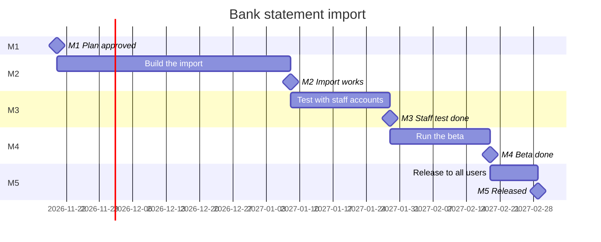
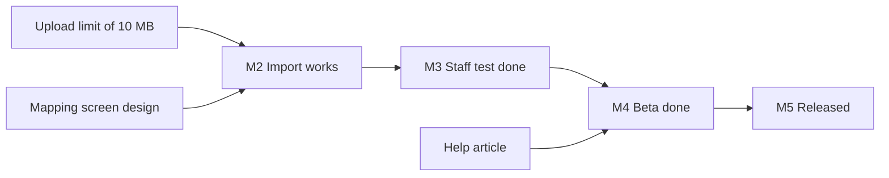

# Bank statement import

## Objective

Give all Ledgerly users an import of CSV bank statements by 2027-03-01. Success is a median time of 5 minutes or less to record one month of transactions, measured in recorded sessions with 12 users.

## Scope

In:

- Requirements R1 to R5 of the [requirements](requirements.md): upload, column mapping, duplicate check, preview, and saved mappings
- A help article, and training for the support team

Out:

- Undo of an import (R6, a `Could` requirement)
- Files in a format other than CSV
- A live connection to a bank

## Milestones

| Milestone | Outcome | Owner | Target date | Status |
| --- | --- | --- | --- | --- |
| M1 Plan approved | The requirements and this plan are approved. | Priya Nair | 2026-11-20 | On track |
| M2 Import works | A staff user imports a statement from each of the 5 test banks. | Tomás Ruiz | 2027-01-08 | Not started |
| M3 Staff test done | 5 staff accounts import 2 weeks of statements with no duplicate. | Sam Okafor | 2027-01-29 | Not started |
| M4 Beta done | 40 of 50 beta users complete an import. | Priya Nair | 2027-02-19 | Not started |
| M5 Released | All users can import a statement. | Priya Nair | 2027-03-01 | Not started |

## Timeline

## Work breakdown

### M1 Plan approved

- [x] Write the requirements. Owner: Priya Nair.
- [x] Write decision record 0007, about the column mapping. Owner: Tomás Ruiz.
- [ ] Get approval for the requirements and this plan. Owner: Priya Nair.

### M2 Import works

- [ ] Design the mapping screen. Owner: Mei Chen.
- [ ] Raise the limit of the upload service to 10 MB. Owner: Tomás Ruiz.
- [ ] Build the CSV reader and the mapping step. Owner: Tomás Ruiz.
- [ ] Build the preview and the duplicate check. Owner: Ana Costa.

### M3 Staff test done

- [ ] Write the test plan from the "How to check" column of the requirements. Owner: Sam Okafor.
- [ ] Run the import on 5 staff accounts for 2 weeks. Owner: Sam Okafor.

### M4 Beta done

- [ ] Invite the 50 users who asked support for an import. Owner: Priya Nair.
- [ ] Write the help article. Owner: Lena Hoffmann.
- [ ] Train the support team. Owner: Lena Hoffmann.

### M5 Released

- [ ] Turn on the import for all users. Owner: Tomás Ruiz.
- [ ] Record 12 sessions and measure the median time. Owner: Mei Chen.

## Dependencies

## Risks

| Risk | Likelihood | Impact | Response | Owner |
| --- | --- | --- | --- | --- |
| The upload limit stays at 5 MB. | Low | Medium | Accept 5 MB in the beta, and change R1 if the limit stays. | Tomás Ruiz |
| Fewer than 40 beta users complete an import by 2027-02-19. | Medium | High | Ask support to contact the beta users who did not start. | Priya Nair |
| A test bank changes its layout during the staff test. | Medium | Low | Map the new layout, and add the change to the test log. | Sam Okafor |

## Roles

| Role | Person | Responsibility |
| --- | --- | --- |
| Product owner | Priya Nair | Scope, priorities, and the beta |
| Engineering lead | Tomás Ruiz | The reader, the mapping, and the release |
| Engineer | Ana Costa | The preview and the duplicate check |
| Designer | Mei Chen | The mapping screen and the measured sessions |
| Test lead | Sam Okafor | The test plan and the staff test |
| Support lead | Lena Hoffmann | The help article and the training |

## Status updates

Priya Nair writes a status update every Friday in the `#bank-import` channel. The update gives the status of each milestone and each new risk. She changes the Status column of the milestones table on the same day.

## Exit criteria

- [ ] R1 to R5 pass their checks in production.
- [ ] The median time to record one month of transactions is 5 minutes or less, in 12 recorded sessions.
- [ ] The help article is published.
- [ ] The import has no open bug of severity 1 or 2.
