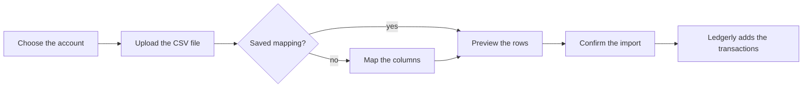

# Bank statement import

## Summary

Ledgerly users type each bank transaction by hand. We propose an import that reads the CSV statement of a bank account and adds its transactions to Ledgerly. We expect the time to record one month of transactions to fall from 45 minutes to 5 minutes or less.

## Problem

Ledgerly has no way to add many transactions at one time. A user types each transaction into the form on the Transactions page.

- In the survey of 2026-09, 212 of 340 users (62 %) named manual entry as their largest problem.
- Support received 87 requests for an import in Q3 2026.
- In 12 recorded sessions, users needed a median of 45 minutes to enter one month of transactions.

Owners of small businesses who keep their own books have this problem. Accountants have it for each client that they keep books for.

## Goals and non-goals

Goals:

- A user records one month of transactions from one bank account in 5 minutes or less.
- An import adds no transaction that is already in Ledgerly.

Non-goals:

- A live connection to a bank. [Decision record 0007](adr.md) explains why.
- Files in a format other than CSV, such as OFX or PDF.
- Categories for imported transactions.

## Users and use cases

- As the owner of a small business, I want to import the monthly CSV statement of my bank, so that I do not type each transaction.
- As an accountant, I want Ledgerly to keep the column layout of each client's bank account, so that the next import from that account needs no setup.
- As the owner of a small business, I want the import to skip transactions that are already in Ledgerly, so that my balance stays correct.

## Requirements

| ID | Requirement | Priority | How to check |
| --- | --- | --- | --- |
| R1 | The import must accept a CSV file of up to 10 MB. | Must | Import a 10 MB file. The preview shows all of its rows. |
| R2 | The user must map the date, amount, and description columns before the import adds a transaction. | Must | Start an import. No transaction is added before the user saves the mapping. |
| R3 | The import must skip a row whose date, amount, and description match a transaction in the same account. | Must | Import the same file two times. The second import adds 0 transactions. |
| R4 | The preview must show each row that the import cannot read, with the reason. | Must | Import a file with one invalid date. The preview shows that row and "Invalid date". |
| R5 | Ledgerly must offer the saved mapping of a bank account at the next import into that account. | Should | Import two files into one account. The second import opens with the first mapping. |
| R6 | The user must be able to undo a complete import for 24 hours after it. | Could | Undo an import. The balance equals the balance before the import. |

## Success metrics

| Metric | Now | Target | How measured |
| --- | --- | --- | --- |
| Median time to record one month of transactions | 45 minutes | 5 minutes or less | Recorded sessions with 12 users |
| Support requests for an import in a quarter | 87 | 10 or fewer | Support tickets with the tag `import` |
| Users who import at least one file in their first 30 days | 0 % | 40 % | Product analytics, event `import_completed` |

## Flow

## Dependencies

- The upload service must accept files of 10 MB. Its limit is now 5 MB. Owner: Tomás Ruiz. Needed by 2026-12-11.
- The design of the mapping screen. Owner: Mei Chen. Needed by 2026-12-04.

## Risks

| Risk | Likelihood | Impact | Response |
| --- | --- | --- | --- |
| A bank writes dates in a format that the import cannot read. | High | Medium | The mapping step lets the user choose the date format. |
| The duplicate check skips two real transactions with the same date, amount, and description. | Low | High | The summary after the import lists each skipped row. |
| The upload limit stays at 5 MB. | Low | Medium | Accept 5 MB in the beta, and change R1 if the limit stays. |

## Open questions

- [x] Which banks do we test with first? Owner: Priya Nair. Answer: the 5 banks that most users name in the survey.
- [ ] Must the import read files that use a semicolon as the separator? Owner: Tomás Ruiz.
- [ ] Can an accountant import into the account of a client without the client's approval? Owner: Priya Nair.

## Rollout

1. Staff: 5 staff accounts import their own statements. Go on when the import adds no duplicate transaction in 2 weeks.
2. Beta: 50 users who asked support for an import. Go on when 40 of them complete an import and no `Must` requirement fails.
3. All users. The [project plan](project-plan.md) gives the dates.
