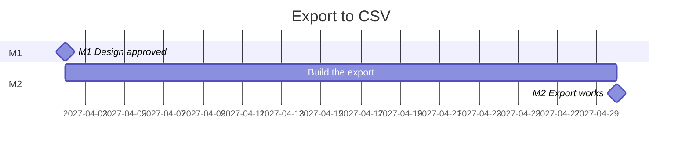

# Project plans

A project plan says what a project will deliver, who delivers each part, and when. A roadmap and a rollout plan use the same shape.

## File

Use the file name and the folder of the repository's plans. If the repository has none, write `docs/plans/<name-in-kebab-case>.md`, for example `docs/plans/bank-statement-import.md`.

## Front matter

| Key | Value |
| --- | --- |
| `status` | `Draft`, `Active`, or `Closed` |
| `owner` | The person who keeps the plan current |
| `updated` | The date of the last change to the text, as `YYYY-MM-DD` |

A plan is `Active` only when the user says that the work started. A new plan is `Draft`.

## Sections

Write these sections in this order. Each is a `##` heading under the one `#` title. The title names the project.

1. **Objective.** One sentence that says what the project delivers, and one sentence that says how success is measured.
2. **Scope.** Two lists, "In" and "Out". Put a thing in "Out" when a reader can expect it but the project will not do it.
3. **Milestones.** The milestones table. See [The milestones table](#the-milestones-table).
4. **Timeline.** A Mermaid `gantt` built from the milestones table. See [The timeline](#the-timeline).
5. **Work breakdown.** A `###` heading for each milestone, with a task list of its work. Each task has one owner.
6. **Dependencies.** The things that must finish before other things can start. With more than 3 edges, draw a Mermaid `flowchart`. With 3 edges or fewer, write a bullet list. An edge is one "A must finish before B starts".
7. **Risks.** A table with the columns `Risk`, `Likelihood`, `Impact`, `Response`, and `Owner`. Likelihood and impact are `Low`, `Medium`, or `High`.
8. **Roles.** A table with the columns `Role`, `Person`, and `Responsibility`.
9. **Status updates.** Who writes them, how often, and where.
10. **Exit criteria.** A task list of conditions that a person can check, such as a test result or a measured value. The project ends when all are checked.

## The milestones table

The table has the columns `Milestone`, `Outcome`, `Owner`, `Target date`, and `Status`.

- **Milestone.** A short name. Number the milestones `M1`, `M2`, and so on, in date order.
- **Outcome.** The result that shows the milestone is reached, not the work: "Five staff accounts import a month of statements", not "Testing".
- **Owner.** One person.
- **Target date.** A date from the sources, as `YYYY-MM-DD`. Never estimate a date. Write `TBD`.
- **Status.** `Not started`, `On track`, `At risk`, `Late`, or `Done`.

## The timeline

Draw the `gantt` only from the milestones table.

- Make one `section` for each milestone, named with its ID only, such as `M1`. Mermaid writes the section name over the start of the chart, so a long name covers the first marker.
- In each section, draw one `milestone` marker on the target date of the milestone, labeled with the name from the table.
- Draw the work of a milestone as one bar. The bar starts on the target date of the milestone before it and ends on its own target date. The first milestone has no bar.
- Leave out a milestone with a `TBD` date, and say so in the reply.

````markdown

````

After you draw it, check each date in the diagram against the table. Each date in the diagram must be a target date in the table.

## Check

- [ ] The objective is one sentence, and success has a measure.
- [ ] Each milestone has one owner, a person, and a date from the sources or `TBD`.
- [ ] Each date in the `gantt` is a target date in the milestones table.
- [ ] Each task, risk, and dependency has one owner.
- [ ] Dependencies with more than 3 edges are a `flowchart`. Fewer are a list.
- [ ] Each exit criterion is a condition that a person can check.
