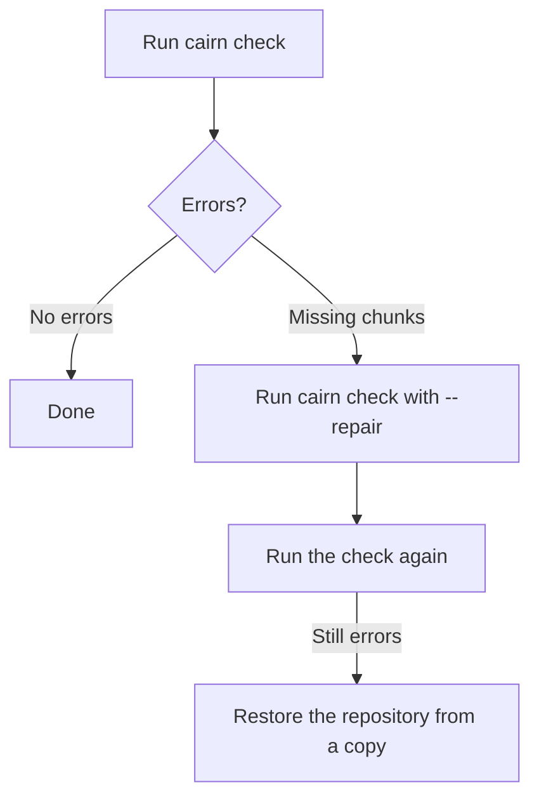

# cairn

cairn is a command-line tool that takes snapshots of a directory and stores them in a repository, so that you can get back any earlier state of your files.

- cairn is written in Go and runs on macOS, Linux, and Windows.
- The current version is 0.9.2.
- cairn deduplicates each snapshot. A second snapshot of a folder that did not change takes almost no space.
- cairn encrypts each snapshot with AES-256 before it leaves your machine.
- Volunteers maintain the project. It is released under the Apache 2.0 license.
- Bug reports are welcome at <https://github.com/example/cairn/issues>.

## Install

You need Go 1.22 or later. You can download it from <https://go.dev/dl/>.

1. Install cairn.

   ```sh
   go install example.com/cairn/cmd/cairn@v0.9.2
   ```

2. Make sure that `$HOME/go/bin` is on your `PATH`.
3. Check that the install worked.

   ```sh
   cairn version
   ```

   The command should print `cairn 0.9.2`.

## Quick start

1. Create a repository.

   ```sh
   cairn init ~/cairn-repo
   ```

2. Take your first snapshot.

   ```sh
   cairn snap ~/projects --repo ~/cairn-repo --tag first
   ```

You can list every snapshot in the repository with `cairn list --repo ~/cairn-repo`. The list shows the ID, the date, and the tags of each snapshot.

## Compression

cairn can compress a snapshot in three ways. Choose one with the `--compress` flag. The default is `zstd`.

In our test on a 10 GB source tree, the three ways gave these results:

| `--compress` | Time | Size of the result | Note |
| --- | --- | --- | --- |
| `zstd` | 4 minutes | 3.1 GB | The default |
| `gzip` | 9 minutes | 3.4 GB | Other tools can read it |
| `none` | 2 minutes | 10 GB, the full size | |

## Restore files

To restore, pass the ID of the snapshot and a target folder to `cairn restore`. The target folder must be empty.

```sh
cairn restore 4f2a9c --repo ~/cairn-repo --target ~/restored
```

Restoring from a repository on a network drive might be slower than restoring from a local disk.

## Check a repository



1. Verify the repository with `cairn check --repo ~/cairn-repo`. If it reports no errors, you are done.
2. If it reports missing chunks, run `cairn check --repo ~/cairn-repo --repair`.
3. Run the check again.

If it still reports errors after the repair, the repository may be damaged, and you should restore it from a copy.

## Configuration

cairn reads its settings from `~/.config/cairn/config.toml`. A command-line flag overrides the same setting in the file.

```toml
[repo]
path = "~/cairn-repo"

[retention]
daily = 7
weekly = 4
```

## Prune old snapshots

The `cairn prune` command removes old snapshots according to the `[retention]` settings. With the settings above, it keeps the last 7 daily and 4 weekly snapshots. The command prints the ID of each snapshot that it removes. It does not touch snapshots that have a tag.

> [!WARNING]
> Prune deletes data permanently. There is no way to get a pruned snapshot back. Always run `cairn prune` with `--dry-run` first.

## License

Apache 2.0. See `LICENSE`.
